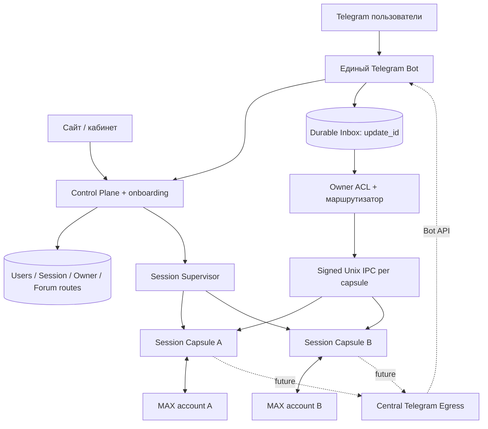
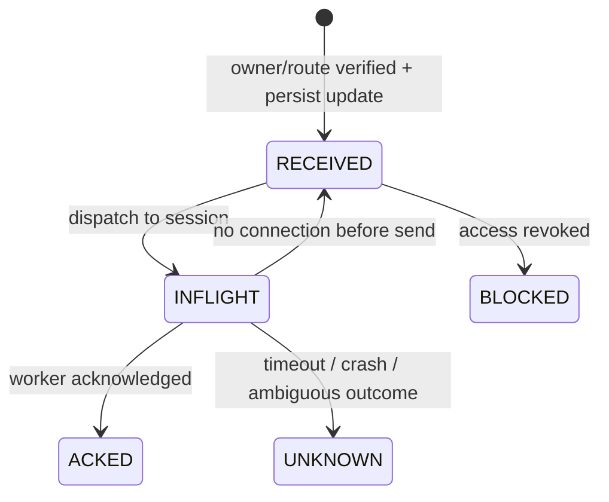

# MAX2TG P2.2 — один Telegram-бот для всех пользователей

Дата: 23.10.2026. Статус: **P2.2a — реализовано ядро архитектуры и
offline-тесты. Рабочий многопользовательский бот НЕ запущен.**

## Логическая схема

Вся система использует **один публичный Telegram Bot API token**,
один процесс-получатель getUpdates либо единственный HTTPS webhook,
и один центральный API отправки сообщений. MAX-аккаунты работают
обособленно: отдельный легковесный WebSocket-клиент, процесс,
защищённый каталог, outbox, курсоры, mappings, heartbeat, browser
profile для первоначального логина.

## Реализованное P2.2a

- app/telegram_control_plane.py: таблицы владельцев, одноразовые
  ограниченные по времени Telegram-приглашения (в БД лишь SHA256),
  уникальная привязка форум-супергруппы к Session Capsule, статусы
  PENDING / ACTIVE / DISABLED. Доступ строго по настоящим Telegram
  chat.id + from_user.id, никогда по тексту или callback_data.
  Реальная проверка прав бота и членства владельца — перед ACTIVE.
- app/telegram_inbox.py: SQLite журнал входящих Telegram updates
  с уникальным update_id, границами размера, fingerprint,
  RECEIVED→INFLIGHT→ACKED/UNKNOWN. При неопределённом результате
  UNKNOWN НЕ повторяется автоматически; при отсутствии соединения
  до начала записи безопасный retry. При отзыве доступа BLOCKED.
- app/telegram_gateway.py: единый gateway engine, последовательная
  обработка по session_id, восстановление только однозначно
  неотправленных событий и фабрика одного PTB Application. В коде
  есть приватный /start для одноразовой привязки и минимальный /status.
- app/telegram_ipc.py: Unix socket внутри закрытого корневого
  каталога SaaS, отдельный HMAC-ключ для каждой Session Capsule,
  подписанные ограниченные кадры и явный ответ worker. Приёмник
  дополнительно сверяет Telegram chat.id/from_user.id со своими
  локальными правами, независимо от решения центрального gateway.
  TCP-порт не открывается. Утерянный ответ — UNKNOWN.
- tests/test_telegram_control_plane.py: offline тесты маршрутизации
  двух владельцев, дедупликации, запрета пересечения чужих чатов,
  отзыва доступа, ACK/UNKNOWN и безопасных повторов.

## Жизненный цикл входящего сообщения

**Важная оговорка:** ACK от IPC подтверждает результат обработчика
worker, но не гарантирует доставку в MAX без отдельного устойчивого
TG→MAX outbox. Telegram также не даёт строгую exactly-once
семантику сетевой доставки.

## Безопасность

Вход из Telegram привязывается к зарегистрированному User только
по одноразовой ссылке/коду в приватном чате. Группу нужно независимо
проверить через getChat и getChatMember: это приватный forum,
владелец является участником, бот — администратор.
Анонимные посты, неразрешённые участники и неизвестные группы
отклоняются без помещения текста в очередь.

Все session state разделены. В IPC используются локальные ключи
0600 и каталоги 0700. Однако центральный Telegram Inbox содержит
текст обновлений в SQLite: до SaaS beta обязательны шифрование,
изоляция пользователей ОС/контейнеров, ограниченное хранение
и удаление данных, резервирование и подготовка документов по ПДн.

## Что ещё НЕ реализовано (P2.2b)

1. Worker не должен самостоятельно получать getUpdates. Нужно встроить
   IPC-вход в работающее приложение MAX2TG и отдельный durable
   TG→MAX outbox, независимый от Telegram polling.
2. Все исходящие send/edit/delete/media нужно отправлять **через
   центральный Telegram Egress**, которому одному известен общий
   токен, а Telegram ID подтверждений возвращать конкретной сессии.
3. Мигрировать P2.1 registry: убрать требование уникального
   Telegram bot fingerprint на каждую сессию, запретить хранить
   общий bot token в tenant worker, сохранить личный мост отдельно.
4. Реализовать проверку Telegram forum через настоящий Bot API,
   UI входа/привязки групп, revoke/delete/reauth, ограничение расходов.
5. Провести двусторонние тесты двух dummy workers через один gateway,
   затем два реальных MAX-аккаунта и отдельный тестовый Telegram-бот.

## Эксплуатационный статус

Рабочие личные launchd-службы на Mac mini не менялись. Общий
Telegram Bot API token не использовался; общая служба не запускалась,
новые реальные пользователи/сессии не создавались. Это архитектурный
фундамент P2.2a, НЕ готовый SaaS.

Официальные источники:
- https://core.telegram.org/bots/api
- https://core.telegram.org/bots/faq
